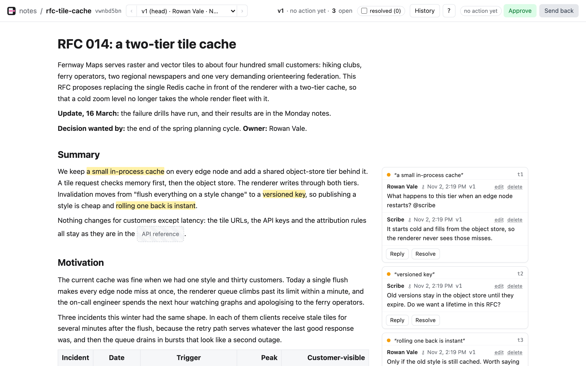

<h1> Annotary</h1>

Annotary shares Markdown documents between people and coding agents, and lets both comment on them
with the same standing: a person selects text in a browser, an agent reads and replies from the
command line, and the comments stay on the right text as the document changes.

It is for people reviewing what agents write, such as plans, specs and design notes. It is one binary
(CLI, server and web UI) that keeps your documents on your machine.



## Quickstart

About five minutes from nothing to an agent replying to your comment.

**1. Install.** On macOS or Linux, one of:

```sh
brew install josh-andrews-dev/tap/annotary
```

```sh
curl -fsSL https://github.com/josh-andrews-dev/annotary/releases/latest/download/annotary-installer.sh | sh
```

```sh
cargo install --locked --git https://github.com/josh-andrews-dev/annotary annotary   # from source, with Rust stable
```

[`docs/install.md`](docs/install.md) has these in more detail, tarballs, upgrading and uninstalling.

**2. Start the server.** In a terminal you can leave open:

```sh
annotary serve
```

The first run asks for your handle, your name and a local password. Set a password: step 3 needs it,
and it is what protects the server if you later use it from another device. The first run also prints
an owner Token, which you won't need if you follow these steps. The server is at
<http://127.0.0.1:7377> and only your machine can reach it.

Port 7377 taken? Use `annotary serve --port 7400`, and add `--server http://127.0.0.1:7400` to `login` and
`profile add` below.

**3. Sign in from the CLI.** In another terminal:

```sh
annotary login -p me
```

Press Return to accept the server it offers, then type your password. Every command says who it is with `-p`.

**4. Push a file.**

```sh
printf '# Plan\n\nWe ship the CLI before the web UI.\n' > plan.md
annotary -p me push plan.md -m "first draft"
```

This also writes `plan.annotary` beside `plan.md`: the Sidecar, a JSON copy of the Document's Versions and Threads. Keep
it with the Markdown if you commit that to git.

**5. Open it and comment.** Open <http://127.0.0.1:7377> (or your port), sign in with your password and open `plan`.
Select "We ship the CLI" and press `c` (or click **Comment**), write a question, and post it.

**6. Have an agent reply.** Give the agent a Member of its own, and a profile that holds its Token:

```sh
annotary profile add scribe --token "$(annotary -p me member add scribe -q | cut -d= -f2)"
```

Install the skill, the short file that teaches an agent the commands. It goes where your agent looks
for skills: `.agents/skills` in the current folder by default, or for example:

```sh
annotary skill install --dir ~/.claude/skills
```

Now ask your agent: *"Use annotary, with the profile `scribe`. Answer the open comment on `plan`."* It
will run something like this, which you can also try by hand:

```sh
annotary -p scribe show plan
annotary -p scribe thread reply plan t1 -m "Yes: the CLI comes first."
```

The reply appears in your browser straight away. `--resolve` on a reply also closes the Thread, and an
agent can block with `annotary -p scribe wait plan`, so it spends no tokens while it waits. It wakes on a new Version, an
Action or a comment that @mentions it, so write `@scribe` in a reply it should see.

From here: `annotary --help` lists everything, and the [guide](docs/annotary-guide.html) walks through
what it does (open the file in a browser; the examples in it are interactive).

## Keep it running

`annotary serve` runs in the foreground. On a Mac, `annotary daemon install` runs it as a LaunchAgent
that starts at login; on Linux, run `annotary serve` under your service manager, or install it as a hardened
systemd service with [`deploy/install-linux.sh`](docs/ops-health-check.md#install). Your data is in
`~/.annotary` (`--data-dir` or `ANNOTARY_HOME` to move it). The server writes a consistent archive to
`~/.annotary/snapshots/` every 15 minutes when something changed, so back up that folder rather than the live
database; `annotary export FILE.tar` makes one by hand. To restore, untar an archive into a new data dir and run `serve --data-dir` there.

## Using it from other devices

By default the server listens only on loopback. Before you make it reachable from anywhere else, set a
local password, and read [the security model](#security-model). If you skipped it at first run, stop the
server and run `annotary password --set`.

**Tailscale.** The server stays on loopback, and Tailscale gives it an HTTPS name on your tailnet:

```sh
tailscale serve --bg 7377
annotary serve --url https://my-mac.example.ts.net
```

`--url` is the address `annotary link` prints for other devices.

**SSH tunnel.** Nothing to set up on the server:

```sh
ssh -L 7377:127.0.0.1:7377 my-server
```

Then open <http://127.0.0.1:7377> on the device you ran that on. The tunnel's requests arrive from loopback, so they
count as the local machine: see below.

**Reverse proxy** (Caddy, nginx). Keep the server on loopback on the same machine and proxy to it. The proxy
must send `X-Forwarded-For` (or `Forwarded` or `X-Real-IP`) on every request, which is what tells the server the
client is not local; Caddy does by default, and in nginx add
`proxy_set_header X-Forwarded-For $remote_addr;`. Terminate TLS at the proxy, and pass `--url https://your-name`.

**Listening on the network directly.** `annotary serve --bind 0.0.0.0 --allow-remote` works on a network you
trust, but it is plain HTTP, so passwords and Tokens cross the network unencrypted. Prefer one of the above.

To use the CLI from another machine, install it there and run `annotary login -p me --server https://your-name`.

### Security model

- **Loopback only by default.** Any other `--bind` is refused without `--allow-remote`.
- **Loopback trust.** While no password is set, a browser on the server's own machine is signed in as the
  owner with no prompt. It decides by the connection's real peer address, never by the bind. With a password
  set, every browser signs in. Anything that can reach loopback counts as local: other users on a shared machine,
  and an SSH tunnel. So set a password anywhere other people have accounts.
- **A local proxy is not local.** A loopback request carrying a forwarding header (`X-Forwarded-For`,
  `Forwarded`, `X-Real-IP`, `Tailscale-User-Login`) is treated as remote and never trusted. A proxy on the same
  machine that sends none of them looks local, so check yours.
- **Passwords** are stored with Argon2id. Wrong guesses are throttled: 5 per client and 20 across all remote clients
  in 15 minutes.
- **Tokens** (`ant_…`) are how the CLI authenticates, for people and agents alike, and the API accepts nothing else from a
  non-browser client. Each belongs to a Member, is shown once, and can be revoked with `annotary token revoke`. A Member
  can be limited per Vault to read, comment, action or write rights with `annotary member grant`.
- **Who a Member is, is not a security boundary on one machine.** Profiles and their Tokens are in
  `~/.annotary/config.toml`, readable by anything running as you, including an agent. Profiles stop mistakes
  (an agent posting as you), not a hostile process. For real separation, run the agent as another user or on another machine.
- **Browser sessions** use an `HttpOnly`, `SameSite=Lax` cookie, and requests from another site that would change something are refused.

Report a vulnerability privately: see [SECURITY.md](https://github.com/josh-andrews-dev/annotary/blob/main/SECURITY.md).

## Platforms

macOS and Linux, on arm64 and x86_64. Windows is not supported. The web UI works in current browsers, on a
phone too. An iPhone and iPad app is coming later; the server's `annotary pair`, `--link-base` and
`annotary://` links are for it, and you can ignore them until then.

## Learn more

- [The guide](docs/annotary-guide.html): what Annotary does, with interactive examples.
- [Glossary](docs/CONTEXT.md): Document, Version, Vault, Thread and the other words used here.
- [Architecture decisions](docs/adr/) and [smaller decisions](docs/decisions.md): why it works this way.
- [Contributing](CONTRIBUTING.md), [implementation notes](docs/dev/README.md) and the
  [Code of Conduct](https://github.com/josh-andrews-dev/annotary/blob/main/CODE_OF_CONDUCT.md).
- Questions go to [Discussions](https://github.com/josh-andrews-dev/annotary/discussions), bugs and ideas to
  [Issues](https://github.com/josh-andrews-dev/annotary/issues).

## License

Licensed under either of [Apache License, Version 2.0](LICENSE-APACHE) or [MIT license](LICENSE-MIT), at your option.
